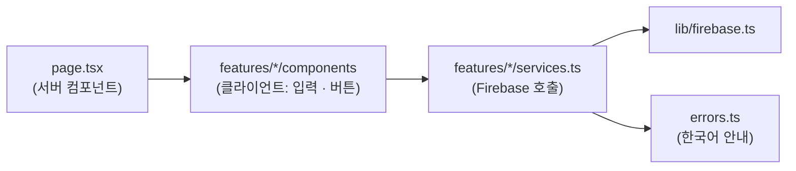

# 파일 구조

Next.js App Router 기반. **화면(라우트)은 `app/`, 기능 코드는 `features/<기능>/`** 에 둔다.

```
TeamKit/
├─ .github/PULL_REQUEST_TEMPLATE.md   PR 본문 양식
├─ docs/                              설계 문서 (이 폴더)
├─ firestore.rules                    Firestore 보안 규칙
├─ firebase.json · .firebaserc        Firebase CLI 설정 (규칙 배포 · 에뮬레이터)
├─ tests/firestore.rules.test.mjs     보안 규칙 자동 테스트 (에뮬레이터)
├─ .env.local.example                 Firebase 웹 설정 예시 (실제 값은 .env.local, 커밋 안 함)
└─ src/
   ├─ app/                            라우트 (폴더 = URL)
   │  ├─ layout.tsx                   전체 레이아웃 · 글꼴 · AuthProvider
   │  ├─ globals.css                  디자인 토큰 (색 · 글꼴)
   │  ├─ page.tsx                     / → /projects 로 이동
   │  ├─ (auth)/                      로그인 전 화면 묶음 (괄호 = URL에 안 들어감)
   │  │  ├─ layout.tsx                로고 헤더 + 가운데 정렬 + 로그인한 사람은 밖으로
   │  │  ├─ login/page.tsx            /login
   │  │  ├─ signup/page.tsx           /signup
   │  │  └─ reset-password/page.tsx   /reset-password
   │  ├─ projects/page.tsx            /projects 내 프로젝트 목록
   │  ├─ account/page.tsx             /account 계정 설정 (GitHub 연결)
   │  └─ p/[projectId]/               프로젝트 내부 (멤버가 아니면 접근 불가 화면)
   │     ├─ layout.tsx                사이드바 + 상단바 틀 (ProjectShell)
   │     ├─ page.tsx                  대시보드
   │     └─ board · meetings · polls · github · settings /page.tsx
   │
   ├─ features/                       기능별 코드
   │  └─ auth/
   │     ├─ services.ts               Firebase 호출 (가입 · 로그인 · GitHub 연결 · 재설정)
   │     ├─ AuthProvider.tsx          로그인 상태 구독 · useAuth()
   │     ├─ validation.ts             입력값 검증 규칙
   │     ├─ errors.ts                 Firebase 오류 코드 → 한국어 안내
   │     ├─ types.ts                  Firestore 문서 · 결과 타입
   │     └─ components/               이 기능에서만 쓰는 화면 조각
   │        ├─ LoginForm · SignupForm · ResetPasswordForm
   │        ├─ GithubButton · GithubLinkRow
   │        ├─ AuthGate                로그인 여부로 화면 접근 제어
   │        ├─ UserMenu                헤더의 이름(→ 계정 설정) · 로그아웃
   │        └─ AccountView             계정 설정 화면
   │  ├─ tasks/                       할 일 보드
   │  │  ├─ services.ts               만들기(카드 번호 트랜잭션) · 수정 · 상태 변경(+기록) · 삭제
   │  │  ├─ hooks.ts                  할 일 목록 · 변경 기록 실시간 구독
   │  │  ├─ constants.ts · deadline.ts  상태 · 카드 번호(TM-n) · 지연 일수
   │  │  └─ components/               BoardView · TaskCard · StatusButtons · TaskFormModal · TaskDetailModal
   │  └─ projects/
   │     ├─ services.ts               프로젝트 만들기 · 참여 · 나가기 · 삭제 (배치 쓰기)
   │     ├─ hooks.ts                  내 프로젝트 목록 · 프로젝트 한 개 · 멤버 실시간 구독
   │     ├─ ProjectContext.tsx        내부 화면에서 useCurrentProject() 로 프로젝트 · 멤버 사용
   │     ├─ navigation.ts             사이드바 메뉴 정의 · 현재 메뉴 판별
   │     ├─ inviteCode.ts             초대 코드 생성 · 형식 검사 (규칙과 같은 패턴)
   │     ├─ types.ts
   │     └─ components/               ProjectsView · ProjectCard · NewProjectModal ·
   │        │                         JoinProjectModal · ProjectSettingsView · DangerZone ·
   │        │                         DeleteProjectModal · LeaveProjectModal · NoAccess
   │        └─ shell/                 ProjectShell(멤버 확인 + 틀) · Sidebar · ProjectSwitcher(프로젝트 전환) · Topbar
   │
   ├─ components/                     여러 기능이 같이 쓰는 UI (새로 만들기 전에 여기부터 확인)
   │  ├─ ui/                          Modal · Dropdown · EmptyState · Field(Select · TextArea) · Notice · Icon · Avatar · Tag · button
   │  ├─ layout/                      PlainLayout (사이드바 없는 화면) · PageHeader (페이지 제목)
   │  └─ common/                      BrandMark(로고) · BackLink(뒤로가기) · PlannedFeature(구현 예정 안내)
   ├─ hooks/useTransientState.ts      화면을 떠나면 처음 값으로 돌아가는 상태 (모달 · 드롭다운)
   ├─ lib/firebase.ts                 Firebase 초기화 (브라우저에서 처음 쓸 때 생성)
   ├─ lib/dates.ts                    "YYYY-MM-DD" 날짜 계산 · 표시
   └─ constants/app.ts                앱 이름
```

## 앞으로 추가될 위치

| 기능 | 라우트 | 기능 코드 |
|---|---|---|
| 대시보드 · 간트 | `app/p/[projectId]/` | `features/dashboard/` |
| 회의록 (8~9주차) | `app/p/[projectId]/meetings/` | `features/meetings/` + `functions/` |
| 일정 맞추기 (10주차) | `app/p/[projectId]/polls/` | `features/polls/` |
| GitHub 연동 (11~12주차) | `app/p/[projectId]/github/` | `features/github/` + `functions/` |

## 코드 흐름



- **페이지는 서버 컴포넌트**로 두고, 입력·클릭이 필요한 부분만 `"use client"` 컴포넌트로 분리
- 컴포넌트는 Firebase를 직접 부르지 않고 **`services.ts` 함수만 호출** → 결과는 `{ ok: true } | { ok: false, message }` 로 통일해서 화면은 메시지만 보여주면 됨
- Firebase는 빌드(서버 프리렌더) 중에 초기화되지 않도록 `lib/firebase.ts` 에서 **처음 호출될 때** 만든다
