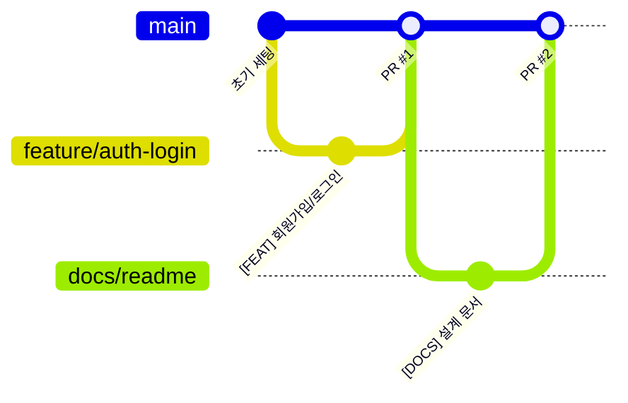

# 개발 규칙

1인 개발 프로젝트지만, 작업 기록을 남기고 되돌리기 쉽게 하기 위해 아래 규칙을 지킨다.

## 1. 작업 흐름

**기능 하나 = 브랜치 하나 = PR 하나**



1. `main` 최신화: `git checkout main && git pull`
2. 브랜치 생성: `git checkout -b feature/기능명`
3. 작업 · 커밋
4. `npm run lint` · `npm run build` 통과 확인
5. 푸시 → PR(`main` 으로) → 본문은 PR 템플릿 형식
6. 머지 → 다음 기능

## 2. 브랜치 이름

| 접두사 | 용도 | 예 |
|---|---|---|
| `feature/` | 새 기능 | `feature/auth-login`, `feature/project-invite` |
| `fix/` | 버그 수정 | `fix/signup-validation` |
| `design/` | 화면만 수정 | `design/board-card` |
| `refactor/` | 동작 변경 없는 구조 개선 | `refactor/auth-services` |
| `docs/` | 문서 | `docs/readme` |
| `chore/` | 설정 · 빌드 | `chore/firebase-functions` |

할 일 보드가 생긴 뒤에는 카드 번호를 넣는다: `feature/TM-12-login` → GitHub 자동 반영 시연에 그대로 사용.

## 3. 커밋 메시지

```
[TYPE] 한 줄 요약

- 무엇을 왜 바꿨는지 (선택)
```

`TYPE`: `FEAT` · `FIX` · `DESIGN` · `REFACTOR` · `STYLE` · `TEST` · `DOCS` · `CHORE`

## 4. PR

- 제목: 커밋 형식과 같음 (`[FEAT] 이메일·GitHub 회원가입/로그인`)
- 본문: [`.github/PULL_REQUEST_TEMPLATE.md`](../.github/PULL_REQUEST_TEMPLATE.md) — 타입, 관련 주차·기능, 작업 내용, 체크리스트, 메모
- 체크리스트는 **실제로 확인한 것만** 체크하고, 확인 못 한 것은 메모에 적는다
- 머지는 Squash and merge (기능 하나 = `main` 커밋 하나)

## 5. 코드 규칙

| 규칙 | 이유 |
|---|---|
| 페이지는 서버 컴포넌트, `"use client"` 는 입력·클릭이 필요한 컴포넌트에만 | 브라우저로 보내는 코드 최소화 |
| Firebase 호출은 `features/*/services.ts` 에만 | 화면과 데이터 로직 분리, 오류 처리 한곳에서 |
| **공통 UI는 `components/ui/` 로 빼서 재사용** — 모달 · 버튼 · 입력 · 태그 · 아바타 · 빈 상태 등 여러 화면에 나오는 것. 새로 만들기 전에 `components/ui/` 부터 확인 | 같은 모양을 여러 번 만들지 않음, 디자인 일관성 |
| 한 기능에서만 쓰는 조각은 `features/<기능>/components/` | 공통 UI와 기능 전용 UI 구분 |
| 모달 · 드롭다운처럼 잠깐 열리는 UI의 열림 상태는 `useTransientState` (`src/hooks/`) | Next 16(cacheComponents)은 이전 화면을 숨겨만 둬서, 일반 `useState` 면 뒤로가기 시 열린 채로 돌아온다 |
| 객체 모양은 `interface`, 유니언·별칭은 `type` | |
| `any` 금지 → `unknown` + 타입 좁히기 | 타입 안정성 |
| 색 · 글꼴은 `globals.css` 디자인 토큰(`text-muted`, `bg-side`, `border-line` …)만 사용 | 디자인 캔버스와 일치 |
| 오류는 한국어 문장으로, 무엇이 문제고 어떻게 하면 되는지 | 사용자 경험 |

## 6. 환경 변수 · 시크릿

- 실제 값은 `.env.local` (커밋 안 함), 예시는 `.env.local.example`
- `NEXT_PUBLIC_` 이 붙은 값은 브라우저에 노출된다 → **공개돼도 되는 값만** (Firebase 웹 설정)
- 시크릿(GitHub Client Secret, CLOVA 키, 웹훅 Secret)은 Firebase 콘솔 / Cloud Functions 환경 변수에만 → [보안 설계](SECURITY.md)

## 7. 실행

```bash
npm install
cp .env.local.example .env.local   # 값 채우기
npm run dev                        # 개발 서버
npm run lint                       # 린트
npm run build                      # 프로덕션 빌드 (개발 서버를 끄고 실행)
npm run test:rules                 # Firestore 보안 규칙 테스트 (에뮬레이터, Java 필요)
npx firebase deploy --only firestore:rules   # 규칙을 실제 프로젝트에 게시
```

- `firestore.rules` 를 바꾸면 **`npm run test:rules` 통과 → 규칙 게시** 순서를 지킨다
- 테스트는 실제 프로젝트가 아닌 에뮬레이터(`demo-teamkit`)에서 돌아서 실데이터에 영향 없음
