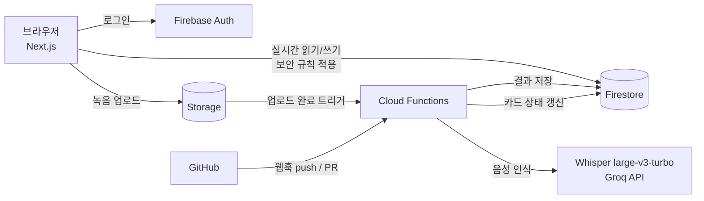
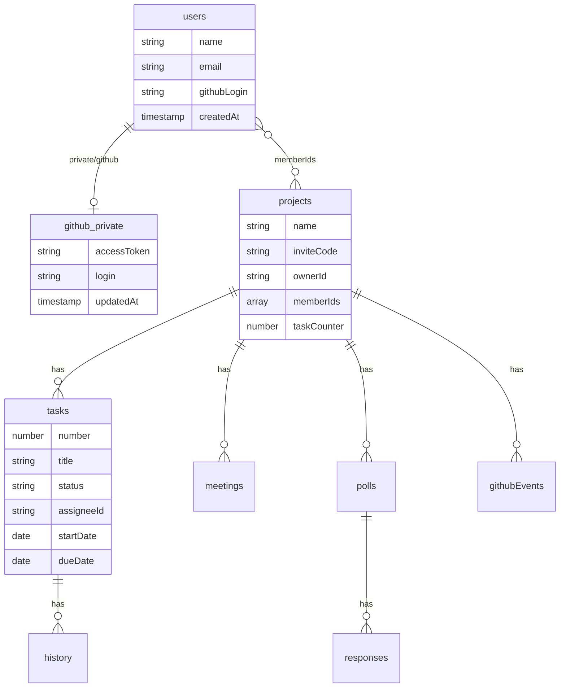

# Firebase 구조

| 항목 | 값 |
|---|---|
| 프로젝트 | `teamkit-8c6d5` |
| Firestore 위치 | `asia-northeast3` (서울) — 사용자가 한국이라 응답 지연 최소화. 생성 후 변경 불가 |
| Firestore 모드 | 프로덕션 모드 (기본 거부) |
| 웹 앱 | `teamkit-web` |
| 로그인 방법 | 이메일/비밀번호, GitHub |

> 표시: ✅ 구현됨 · 🔜 예정(주차)

---

## 1. 서비스 구성

- ✅ Auth, Firestore
- 🔜 Storage · Functions(Whisper 음성 인식) 8~9주차, Functions(GitHub 웹훅) 12주차
- Cloud Functions가 외부 API(Groq Whisper, GitHub)를 호출하려면 **Blaze(종량제) 요금제**가 필요하다.

---

## 2. Firestore 컬렉션

### 상세

| 경로 | 주요 필드 | 상태 | 비고 |
|---|---|---|---|
| `users/{uid}` | `name`, `email`, `githubLogin`, `createdAt` | ✅ | 가입·첫 GitHub 로그인 때 생성 |
| `users/{uid}/private/github` | `accessToken`, `login`, `updatedAt` | ✅ | 본인만 접근 ([보안](SECURITY.md)) |
| `projects/{projectId}` | `name`, `inviteCode`, `ownerId`, `memberIds[]`, `taskCounter`, `createdAt` (+ `github{owner, repo}` 11주차) | ✅ | `memberIds` 배열 → `array-contains` 로 "내 프로젝트" 조회 |
| `inviteCodes/{code}` | `projectId`, `createdAt` | ✅ | 코드 → 프로젝트 찾기. 단건 조회만 허용 |
| `…/joins/{uid}` | `code`, `at` | ✅ | 참여 증명. 규칙이 현재 초대 코드와 비교 ([보안](SECURITY.md#초대-코드-참여-설계-)) |
| `…/tasks/{taskId}` | `number`, `title`, `description`, `status`, `statusSource`, `assigneeId`, `startDate`, `dueDate`, `createdBy`, `createdAt`, `updatedAt` (+ `branch`, `github{…}`, `sourceMeetingId` 11~12주차) | ✅ | `status`: `todo` · `doing` · `done`. 날짜는 `"YYYY-MM-DD"` 문자열(시간대 문제 회피). `startDate`~`dueDate` 로 간트 막대 |
| `…/tasks/{taskId}/history/{id}` | `from`, `to`, `source`(`manual`/`github`), `actor`, `at` | ✅ | 상태 변경 기록. 생성 · 상태 버튼마다 추가 |
| `…/meetings/{meetingId}` | `title`, `recordedAt`, `durationSec`, `audioPath`, `sttStatus`, `segments[]`, `decisions[]`, `actionItems[]` | 🔜 8~9주차 | `sttStatus`: `uploading` · `processing` · `done` · `failed` |
| `…/polls/{pollId}` | `title`, `startDate`, `endDate`, `startHour`, `endHour`, `durationHours`, `status`, `confirmedSlot` | 🔜 10주차 | |
| `…/polls/{pollId}/responses/{uid}` | `slots[]` (`"2026-10-20T19"`), `updatedAt` | 🔜 10주차 | 사람마다 문서 1개 → 동시 입력 충돌 없음 |
| `…/githubEvents/{deliveryId}` | `type`, `title`, `author`, `url`, `taskNumber`, `at` | 🔜 12주차 | 문서 ID = GitHub Delivery ID → 같은 웹훅 중복 처리 방지 |
| `githubRepos/{owner__repo}` | `projectId`, `webhookSecret` | 🔜 12주차 | 클라이언트 접근 금지, Functions만 |

`…` = `projects/{projectId}`

### 설계 이유

- **하위 컬렉션 구조**: 할 일·회의·투표를 프로젝트 아래에 두면 보안 규칙에서 "상위 프로젝트 멤버인가"를 한 번에 검사할 수 있다.
- **카드 번호(`TM-12`)**: `projects.taskCounter` 를 트랜잭션으로 1씩 올려 발급 → 동시에 만들어도 번호가 겹치지 않는다. GitHub 브랜치·커밋·PR의 `TM-12` 와 카드를 연결하는 키.
- **응답을 사람별 문서로**: 투표 응답을 한 문서의 배열로 두면 여러 명이 동시에 수정할 때 덮어쓰기가 생긴다.
- **실시간 동기화**: 보드·회의록은 `onSnapshot` 으로 구독 → 팀원 변경이 새로고침 없이 반영 (문제 1 "진행상황 공유 부재" 해결의 핵심).

---

## 3. Storage 🔜 8주차

| 경로 | 내용 |
|---|---|
| `meetings/{projectId}/{meetingId}.webm` | 회의 녹음 (최대 60분). 해당 프로젝트 멤버만 업로드·재생 |

---

## 4. Cloud Functions 🔜

| 함수 | 트리거 | 하는 일 | 주차 |
|---|---|---|---|
| `transcribeMeeting` | Storage 업로드 완료 | Groq Whisper API 호출 → 문장·타임스탬프 저장 → 규칙 기반 결정사항·할 일 후보 추출 | 9 |
| `githubWebhook` | HTTPS (GitHub 웹훅) | 서명 검증 → 카드 번호 추출 → 카드 상태·PR 정보 갱신 | 12 |

리전은 Firestore와 같은 `asia-northeast3`.
