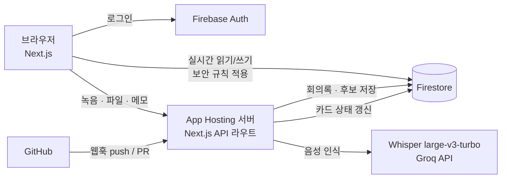
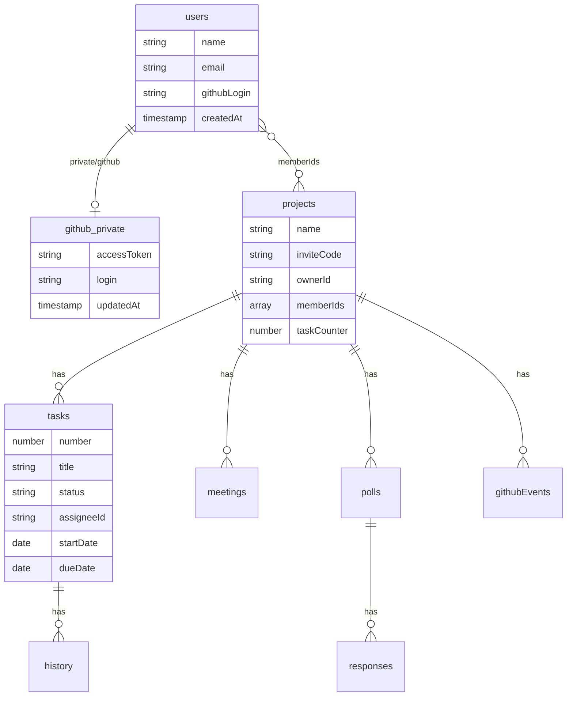

# Firebase 구조

| 항목 | 값 |
|---|---|
| 프로젝트 | `teamkit-8c6d5` |
| Firestore 위치 | `asia-northeast3` (서울) — 사용자가 한국이라 응답 지연 최소화. 생성 후 변경 불가 |
| Firestore 모드 | 프로덕션 모드 (기본 거부) |
| 웹 앱 | `teamkit-web` |
| 로그인 방법 | 이메일/비밀번호, GitHub |

> 표시: ✅ 구현됨 · 🔜 예정(주차)

---

## 1. 서비스 구성

- ✅ Auth, Firestore, App Hosting(Next.js 서버)
- 처음 계획한 Storage + Cloud Functions 대신, **App Hosting 서버의 Next.js API 라우트**가 음성 인식(`/api/meetings`)과 GitHub 웹훅(`/api/github/webhook`)을 처리한다. 서버가 하나라 배포 · 시크릿 관리가 단순하다.
- 녹음 파일은 **저장하지 않는다** (텍스트로 바꾼 뒤 버림) → Storage 불필요, 회의 음성이 남지 않음
- App Hosting(Cloud Run)이 외부 API(Groq Whisper, GitHub)를 호출하려면 **Blaze(종량제) 요금제**가 필요하다.

---

## 2. Firestore 컬렉션

### 상세

| 경로 | 주요 필드 | 상태 | 비고 |
|---|---|---|---|
| `users/{uid}` | `name`, `email`, `githubLogin`, `createdAt` | ✅ | 가입·첫 GitHub 로그인 때 생성 |
| `users/{uid}/private/github` | `accessToken`, `login`, `updatedAt` | ✅ | 본인만 접근 ([보안](SECURITY.md)) |
| `projects/{projectId}` | `name`, `inviteCode`, `ownerId`, `memberIds[]`, `taskCounter`, `createdAt` (+ `github{owner, repo}` 11주차, `milestones[]{id, name, date}` 최대 5개 — 대시보드 D-day 칩 · 간트 깃발) | ✅ | `memberIds` 배열 → `array-contains` 로 "내 프로젝트" 조회 |
| `inviteCodes/{code}` | `projectId`, `createdAt` | ✅ | 코드 → 프로젝트 찾기. 단건 조회만 허용 |
| `…/joins/{uid}` | `code`, `at` | ✅ | 참여 증명. 규칙이 현재 초대 코드와 비교 ([보안](SECURITY.md#초대-코드-참여-설계-)) |
| `…/tasks/{taskId}` | `number`, `title`, `description`, `status`, `statusSource`, `assigneeId`, `startDate`, `dueDate`, `createdBy`, `createdAt`, `updatedAt` (+ `branch`, `github{…}` — 웹훅 서버만 씀) | ✅ | `status`: `todo` · `doing` · `done`. 날짜는 `"YYYY-MM-DD"` 문자열(시간대 문제 회피). `startDate`~`dueDate` 로 간트 막대 |
| `…/tasks/{taskId}/history/{id}` | `from`, `to`, `source`(`manual`/`github`), `actor`, `at` | ✅ | 상태 변경 기록. 생성 · 상태 버튼마다 추가 |
| `…/meetings/{meetingId}` | `title`, `source`(`audio`/`text`), `durationSec`, `segments[]{start, text}`, `decisions[]{text, segment}`, `actionItems[]{text, segment, taskNumber}`, `nextMeeting{date, hour, text}`, `createdBy`, `createdAt` | ✅ | 만들기는 서버(`/api/meetings`)만. 브라우저는 `actionItems` 의 `taskNumber`(보드에 추가됨) · `nextMeeting`(결정사항에서 등록한 다음 회의 → 대시보드)만 수정 |
| `…/polls/{pollId}` | `title`, `startDate`, `endDate`, `startHour`, `endHour`(미포함), `durationHours`(1·2), `status`(`open`/`confirmed`), `confirmedSlot{date, hour}`, `createdBy`, `createdAt` | ✅ | 기간 최대 14일(규칙에서 검사) |
| `…/polls/{pollId}/responses/{uid}` | `slots[]` (`"2026-10-20T19"` = 19시부터 1시간), `updatedAt` | ✅ | 사람마다 문서 1개 → 동시 입력 충돌 없음 |
| `…/githubEvents/{deliveryId}` | `type`(`create`/`push`/`pull_request`), `title`, `author`, `url`, `taskNumbers[]`, `prState`(PR 만: `open`/`merged`/`closed`), `at` | ✅ | 문서 ID = GitHub Delivery ID → 같은 웹훅 중복 처리 방지. 웹훅 서버만 씀 |
| `githubRepos/{owner__repo}` | `projectId`, `fullName`, `webhookSecret`, `hookId`, `connectedBy`, `connectedAt`, `githubMilestones{마일스톤 id: GitHub 번호}` | ✅ | 브라우저 접근 금지, 서버(Admin SDK)만 |

`…` = `projects/{projectId}`

### 설계 이유

- **하위 컬렉션 구조**: 할 일·회의·투표를 프로젝트 아래에 두면 보안 규칙에서 "상위 프로젝트 멤버인가"를 한 번에 검사할 수 있다.
- **카드 번호(`TM-12`)**: `projects.taskCounter` 를 트랜잭션으로 1씩 올려 발급 → 동시에 만들어도 번호가 겹치지 않는다. GitHub 브랜치·커밋·PR의 `TM-12` 와 카드를 연결하는 키.
- **응답을 사람별 문서로**: 투표 응답을 한 문서의 배열로 두면 여러 명이 동시에 수정할 때 덮어쓰기가 생긴다.
- **실시간 동기화**: 보드·회의록은 `onSnapshot` 으로 구독 → 팀원 변경이 새로고침 없이 반영 (문제 1 "진행상황 공유 부재" 해결의 핵심).

---

## 3. 서버 API (App Hosting · Next.js API 라우트) ✅

| 경로 | 호출 | 하는 일 |
|---|---|---|
| `POST /api/meetings` | 브라우저 (Firebase ID 토큰) | 멤버 확인 → 음성이면 Groq Whisper(`whisper-large-v3-turbo`, 한국어) 호출 · 메모면 줄 단위로 나눔 → 규칙 기반 결정사항 · 할 일 후보 추출 → `meetings` 저장 |
| `POST /api/github/repos` · `connect` · `disconnect` | 브라우저 (Firebase ID 토큰) | 레포 목록 · 웹훅 등록 · 해제 (연결 시 마일스톤이 있으면 GitHub 마일스톤도 생성) |
| `POST /api/github/milestone` | 브라우저 (만든 사람) | 프로젝트 마일스톤 목록 → GitHub Milestone 들 만들기 · 고치기 · 빠진 것 닫기 (한 방향) |
| `POST /api/github/webhook` | GitHub | 서명 검증 → 카드 번호 추출 → 카드 상태 · PR 정보 갱신, 카드 번호가 있는 새 PR 은 가장 가까운 다가오는 마일스톤에 자동 추가 |

리전은 App Hosting 백엔드 `asia-east1`, Firestore 는 `asia-northeast3`. Storage · Cloud Functions 는 쓰지 않는다.
