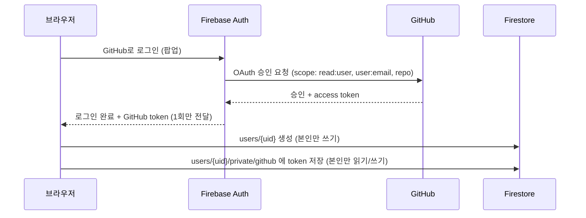

# 보안 설계

TeamKit은 GitHub 토큰, 회의 녹음, 팀원 정보를 다룬다. 별도 백엔드 서버 없이 Firebase를 쓰기 때문에 **브라우저가 DB에 직접 접근**하고, 그래서 보안의 중심은 서버 코드가 아니라 **Firestore 보안 규칙**이다.

> 표시: ✅ 구현됨 · 🔜 예정(주차) · ⚠️ 알려진 한계

---

## 1. 보안 원칙 5가지

| # | 원칙 | 적용 |
|---|---|---|
| 1 | **기본은 전부 거부** | 규칙에 적힌 경로·조건만 허용, 나머지는 모두 차단 (Firestore 프로덕션 모드로 생성) |
| 2 | **본인 데이터는 본인만** | `users/{uid}` 쓰기와 `private` 하위 경로는 `request.auth.uid == uid` 일 때만 |
| 3 | **시크릿은 브라우저에 두지 않음** | GitHub Client Secret · CLOVA 키 · 웹훅 Secret은 코드/저장소에 없음 |
| 4 | **최소 정보 노출** | 비밀번호 재설정은 가입 여부를 알려주지 않음 |
| 5 | **프로젝트 데이터는 멤버만** | 프로젝트·할 일·회의록·투표는 멤버 목록에 있는 사람만 읽기/쓰기 🔜 |

---

## 2. 인증 (Firebase Authentication)



| 항목 | 내용 | 상태 |
|---|---|---|
| 로그인 방식 | 이메일/비밀번호, GitHub OAuth | ✅ |
| 비밀번호 정책 | 8자 이상 + 영문·숫자 포함 (클라이언트 검증, Firebase 최소 6자 정책 위에 추가) | ✅ |
| 비밀번호 저장 | 앱에 저장하지 않음. Firebase Auth가 해시로 보관 | ✅ |
| 같은 이메일 계정 충돌 | GitHub 이메일이 기존 이메일 계정과 같으면 새 계정을 만들지 않고 막음 → 로그인 후 **계정 연결(link)** 로만 붙일 수 있음 (계정 탈취 방지) | ✅ |
| 비밀번호 재설정 | 없는 이메일도 "보냈어요"로 응답 → 가입 여부 조회(계정 열거) 차단 | ✅ |
| 오류 메시지 | 로그인 실패 시 "이메일 또는 비밀번호가 맞지 않아요"로 통일 → 어느 쪽이 틀렸는지 노출 안 함 | ✅ |
| 화면 접근 제어 | 로그인 안 한 사용자는 `/login` 으로 이동 (`AuthGate`) | ✅ |

> ⚠️ 화면 접근 제어는 **편의 기능**이다. 실제 데이터 보호는 아래 Firestore 규칙이 한다. 브라우저 코드는 사용자가 조작할 수 있으므로 규칙 없이는 아무것도 지켜지지 않는다.

---

## 3. Firestore 보안 규칙

규칙 원문: [`firestore.rules`](../firestore.rules)

### 현재 규칙 ✅

```
users/{uid}
  read  : 로그인한 사용자          (팀원 이름 표시용)
  write : 본인만                   (request.auth.uid == uid)

users/{uid}/private/{docId}        (GitHub 토큰)
  read, write : 본인만

그 외 모든 경로 : 거부 (규칙에 없으면 기본 거부)
```

### 프로젝트 규칙 🔜 6주차 (다음 PR)

| 경로 | 읽기 | 쓰기 | 핵심 |
|---|---|---|---|
| `projects/{id}` | 멤버만 | 만든 사람만 (이름·초대 코드) | `request.auth.uid in resource.data.memberIds` |
| 참여 (memberIds에 본인 추가) | – | **초대 코드를 아는 사람만**, **자기 자신만** 추가 가능 | 다른 필드는 못 바꿈, 남을 넣을 수 없음 |
| `projects/{id}/tasks` 등 하위 전부 | 멤버만 | 멤버만 | 상위 프로젝트의 memberIds를 `get()` 으로 확인 |

초대 코드 참여가 가장 까다로운 부분이다. 멤버가 아니면 프로젝트를 읽을 수 없는데, 참여하려면 그 프로젝트를 찾아야 한다. 이를 **코드 → 프로젝트 ID 조회 문서**를 따로 두고, 참여 요청에 코드를 함께 보내 규칙이 프로젝트의 실제 코드와 비교하는 방식으로 푼다. (자세한 설계는 PR #2에서)

---

## 4. 시크릿 관리

| 값 | 어디에 있나 | 브라우저 노출 |
|---|---|---|
| Firebase 웹 설정 (`apiKey` 등) | `.env.local` (`NEXT_PUBLIC_*`) | 노출됨 — **공개용 값**. 보안은 규칙이 담당 |
| GitHub OAuth Client Secret | Firebase 콘솔에만 입력 | ❌ 코드·저장소 어디에도 없음 |
| 사용자 GitHub 토큰 | Firestore `private` 경로 (본인만) | 본인 브라우저에서만 |
| CLOVA Speech API 키 🔜 9주차 | Cloud Functions 환경 변수 | ❌ |
| GitHub 웹훅 Secret 🔜 12주차 | `githubRepos` 컬렉션 (클라이언트 접근 금지) | ❌ |

- `.env.local` 은 `.gitignore` 로 제외, 예시 파일 `.env.local.example` 만 커밋
- PR 체크리스트에 "민감 정보 미포함" 항목 고정

---

## 5. 예정된 보안 작업

| 주차 | 작업 |
|---|---|
| 6주차 | 프로젝트 멤버 규칙, 초대 코드 검증, 멤버가 아닌 사람 접근 차단 화면 |
| 8~9주차 | Storage 규칙: 회의 녹음 파일은 해당 프로젝트 멤버만 업로드·재생 |
| 9주차 | CLOVA API 호출은 Cloud Functions에서만 (키를 브라우저에 두지 않음) |
| 11주차 | GitHub API 호출을 Cloud Functions로 옮기고, `private/github` 의 **클라이언트 읽기 차단** (쓰기만 허용, 서버가 Admin SDK로 읽음) |
| 12주차 | GitHub 웹훅 **서명 검증**(`X-Hub-Signature-256`, HMAC-SHA256) + `X-GitHub-Delivery` 로 중복 처리 방지 |

## 6. 알려진 한계 ⚠️

- **다른 사용자 문서 읽기**: 지금은 로그인한 누구나 `users/{uid}` (이름·이메일)를 읽을 수 있다. 프로젝트 기능이 생기면 "같은 프로젝트 멤버만"으로 좁힐 예정.
- **GitHub 토큰 권한**: 레포 연동을 위해 `repo` 권한을 받는다. 범위가 넓은 권한이라 11주차에 토큰을 서버 전용으로 옮기는 것으로 보완.
- **GitHub 토큰 갱신**: Firebase는 refresh token을 주지 않아 만료되지 않는 토큰을 사용한다(OAuth 앱 설정에서 만료 끔). 사용자가 GitHub에서 앱 권한을 취소하면 다시 연결해야 한다.
