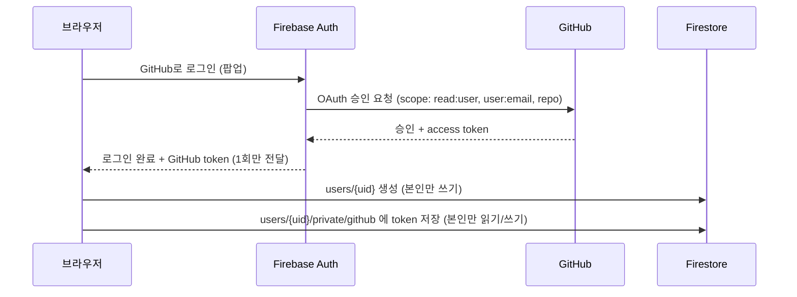
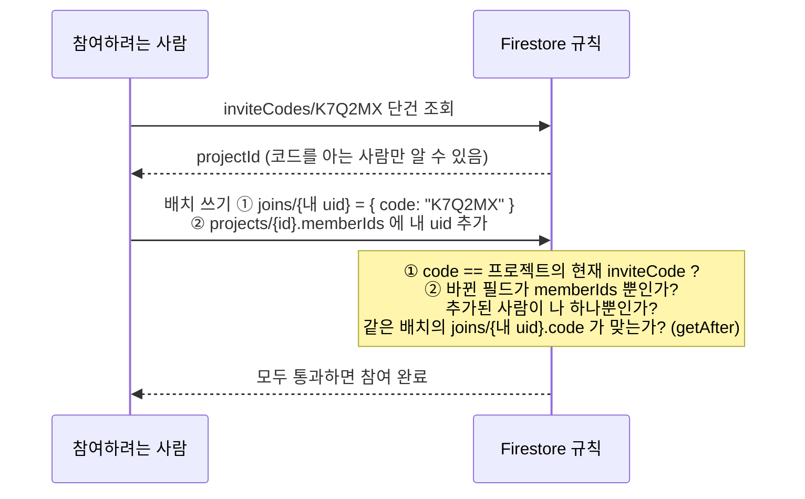
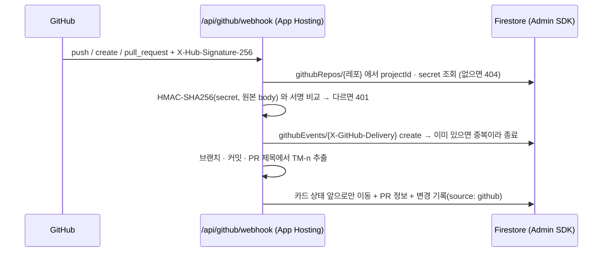

# 보안 설계

TeamKit은 GitHub 토큰, 회의 녹음, 팀원 정보를 다룬다. 별도 백엔드 서버 없이 Firebase를 쓰기 때문에 **브라우저가 DB에 직접 접근**하고, 그래서 보안의 중심은 서버 코드가 아니라 **Firestore 보안 규칙**이다.

> 표시: ✅ 구현됨 · 🔜 예정(주차) · ⚠️ 알려진 한계

---

## 1. 보안 원칙 5가지

| # | 원칙 | 적용 |
|---|---|---|
| 1 | **기본은 전부 거부** | 규칙에 적힌 경로·조건만 허용, 나머지는 모두 차단 (Firestore 프로덕션 모드로 생성) |
| 2 | **본인 데이터는 본인만** | `users/{uid}` 쓰기와 `private` 하위 경로는 `request.auth.uid == uid` 일 때만 |
| 3 | **시크릿은 브라우저에 두지 않음** | GitHub Client Secret · Groq API 키 · 웹훅 Secret은 코드/저장소에 없음 |
| 4 | **최소 정보 노출** | 비밀번호 재설정은 가입 여부를 알려주지 않음 |
| 5 | **프로젝트 데이터는 멤버만** | 프로젝트는 멤버만 읽기 ✅, 할 일·회의록·투표도 같은 방식 🔜 |

---

## 2. 인증 (Firebase Authentication)



| 항목 | 내용 | 상태 |
|---|---|---|
| 로그인 방식 | 이메일/비밀번호, GitHub OAuth | ✅ |
| 비밀번호 정책 | 8자 이상 + 영문·숫자 포함 (클라이언트 검증, Firebase 최소 6자 정책 위에 추가) | ✅ |
| 비밀번호 저장 | 앱에 저장하지 않음. Firebase Auth가 해시로 보관 | ✅ |
| 같은 이메일 계정 충돌 | GitHub 이메일이 기존 이메일 계정과 같으면 새 계정을 만들지 않고 막음 → 로그인 후 **계정 연결(link)** 로만 붙일 수 있음 (계정 탈취 방지) | ✅ |
| 비밀번호 재설정 | 없는 이메일도 "보냈어요"로 응답 → 가입 여부 조회(계정 열거) 차단 | ✅ |
| 오류 메시지 | 로그인 실패 시 "이메일 또는 비밀번호가 맞지 않아요"로 통일 → 어느 쪽이 틀렸는지 노출 안 함 | ✅ |
| 화면 접근 제어 | 로그인 안 한 사용자는 `/login` 으로 이동 (`AuthGate`) | ✅ |

> ⚠️ 화면 접근 제어는 **편의 기능**이다. 실제 데이터 보호는 아래 Firestore 규칙이 한다. 브라우저 코드는 사용자가 조작할 수 있으므로 규칙 없이는 아무것도 지켜지지 않는다.

---

## 3. Firestore 보안 규칙

규칙 원문: [`firestore.rules`](../firestore.rules)

### 현재 규칙 ✅

```
users/{uid}
  read  : 로그인한 사용자          (팀원 이름 표시용)
  write : 본인만                   (request.auth.uid == uid)

users/{uid}/private/{docId}        (GitHub 토큰)
  read, write : 본인만

inviteCodes/{code}                 (초대 코드 → 프로젝트 ID)
  get    : 로그인한 사용자 (코드를 알아야 조회 가능, 목록 조회 불가)
  create : 같은 배치로 만드는 프로젝트의 만든 사람만, 이미 있는 코드는 불가
  delete : 그 프로젝트를 만든 사람만

projects/{projectId}
  read   : 멤버만
  create : 본인이 만든 사람이자 유일한 멤버 + 초대 코드 문서와 같은 배치로만
  update : 참여 — 멤버가 아닌 사람이 자기 자신만 추가, 코드 증명 필요
           나가기 — 만든 사람이 아닌 멤버가 자기 자신만 빠짐
  delete : 만든 사람만

projects/{projectId}/joins/{uid}   (참여 증명)
  create, update : 본인 문서만, 코드가 프로젝트의 현재 초대 코드와 같을 때만
  read           : 만든 사람만 (삭제 때 정리용)
  delete         : 본인(나가기) 또는 만든 사람(프로젝트 삭제)

projects/{projectId}/tasks/{taskId}  (할 일)
  read         : 멤버만
  delete       : 할 일을 만든 사람 · 담당자 · 프로젝트를 만든 사람만 (수정 · 상태 이동은 멤버 누구나, 변경 기록이 남음)
  create       : 멤버 + 같은 트랜잭션에서 taskCounter 를 정확히 1 올리고 그 번호를 카드 번호로 사용
                 (번호 중복 · 건너뛰기 불가), 형식 검사(제목 1~100자, 상태 값, 날짜 형식, 시작일 ≤ 마감일),
                 담당자는 멤버만, createdBy = 본인
  update       : 멤버 + 형식 검사, 카드 번호 · 만든 사람 · 만든 시각은 못 바꿈

projects/{projectId}/githubEvents/{deliveryId}  (GitHub 활동)
  read   : 멤버만 / 쓰기는 웹훅 서버만 (브라우저 쓰기 규칙 없음)

githubRepos/{owner__repo}  (레포 → 프로젝트, 웹훅 secret)
  규칙 없음 → 브라우저 읽기 · 쓰기 전부 거부. 서버(Admin SDK)만 접근

할 일의 branch · github(PR 정보): 브라우저는 만들 때 넣을 수 없고 수정할 때 바꿀 수 없음 → 웹훅 서버만

projects/{projectId}/polls/{pollId}  (일정 투표)
  read   : 멤버만
  create : 멤버 + 형식 검사(기간 최대 14일, 0~24시, 회의 길이 1·2시간), 처음엔 반드시 open · 확정 시간 없음
  update : 투표를 만든 사람만, status · confirmedSlot 만 (확정 · 다시 열기)
  delete : 투표를 만든 사람 · 프로젝트를 만든 사람

projects/{projectId}/polls/{pollId}/responses/{uid}  (가능 시간)
  read   : 멤버만
  write  : 본인 문서만, 투표가 열려 있을 때만, 칸 최대 336개(14일 × 24시간)
  delete : 본인 · 투표를 지울 수 있는 사람

projects/{projectId}/tasks/{taskId}/history/{id}  (상태 변경 기록)
  read         : 멤버만
  delete       : 할 일 삭제 권한이 있는 사람만 (할 일과 함께 삭제)
  create       : 멤버 + actor = 본인, source = manual 만 (GitHub 기록은 서버만 씀) / 수정 불가

그 외 모든 경로 : 거부 (규칙에 없으면 기본 거부)
```

### 초대 코드 참여 설계 ✅

문제: 멤버가 아니면 프로젝트를 읽을 수 없는데, 참여하려면 그 프로젝트를 찾고 자기를 멤버로 넣어야 한다. 그렇다고 "아무나 memberIds에 자기를 추가할 수 있게" 열면 프로젝트 ID만 알면 누구나 들어온다.



- 프로젝트 ID가 유출돼도 **코드 없이는 참여 불가**
- 코드를 재발급하면 이전 코드로는 참여 불가 (joins.code 가 현재 코드와 달라짐)
- 코드 중복은 규칙이 막는다: 이미 있는 `inviteCodes/{code}` 를 다시 쓰면 "수정"이 되어 거부 → 앱이 새 코드로 재시도
- 초대 코드는 헷갈리는 `0 · O · 1 · I` 를 뺀 32자 × 6자리 (약 10억 가지), `crypto.getRandomValues` 로 생성

### 규칙 자동 테스트 ✅

[`tests/firestore.rules.test.mjs`](../tests/firestore.rules.test.mjs) — Firebase 에뮬레이터에서 실제 규칙으로 **58개 시나리오** 검증 (`npm run test:rules`)

| 분류 | 확인하는 것 (예) |
|---|---|
| users | 남의 문서 쓰기 거부, 남의 GitHub 토큰 읽기 거부, 로그인 안 하면 읽기 거부 |
| 프로젝트 만들기 | 코드 문서 없이 생성 거부, 다른 사람을 멤버·만든 사람으로 지정 거부, 중복 코드 거부, 형식 틀린 코드 거부 |
| 프로젝트 읽기 | 멤버는 허용, 멤버가 아니면 거부 |
| 참여 | 맞는 코드면 허용, 틀린 코드 거부, 증명 없이 memberIds 수정 거부, 남까지 끼워 넣기 거부, 다른 필드 수정 거부, 남의 이름으로 증명 쓰기 거부 |
| 나가기 | 자기 자신만 빠지기 허용, 다른 멤버 내보내기 거부, 만든 사람 나가기 거부 |
| 삭제 | 만든 사람은 프로젝트 · 초대 코드 · 참여 기록 한 번에 삭제, 멤버는 프로젝트 · 초대 코드 삭제 거부, 멤버는 참여 기록 목록 조회 거부 |
| 할 일 | 멤버는 번호 +1 과 함께 생성, 비멤버 생성 · 읽기 거부, 번호 건너뛰기 · 중복 거부, 비멤버 담당자 거부, 시작일 > 마감일 거부, 상태 변경 허용, 번호 수정 거부, taskCounter 외 필드 수정 거부, 기록에 남의 이름 · GitHub 출처 쓰기 거부 |
| 할 일 삭제 권한 | 관계없는 멤버 삭제 거부, 만든 사람 · 담당자 · 프로젝트를 만든 사람 삭제 허용 |
| GitHub 연동 데이터 | 멤버는 활동 기록 읽기 허용, 브라우저의 활동 기록 쓰기 거부(가짜 이벤트), 웹훅 secret 읽기 거부, 할 일 PR 정보 위조 거부, 생성 시 브랜치 지정 거부 |
| 일정 투표 | 멤버 생성 허용 · 비멤버 거부, 14일 초과 거부, 처음부터 확정 거부, 만든 사람만 확정, 본인 응답만, 확정 후 응답 거부, 비멤버 응답 조회 거부 |

### 다음 규칙 🔜

| 경로 | 읽기 | 쓰기 | 주차 |
|---|---|---|---|
| `projects/{id}` 이름 변경 · 코드 재발급 · 멤버 내보내기 | – | 만든 사람만 | 프로젝트 설정 화면 |
| 프로젝트 삭제 시 하위 데이터(할 일 · 회의록 등) 정리 | – | Cloud Functions 재귀 삭제 | 하위 데이터가 생긴 뒤 |
| `projects/{id}/meetings` | 멤버만 | 멤버만 | 회의록 (할 일과 같은 `isMember()` 방식) |

---

### 실수 방지 (화면)

- **프로젝트 삭제**: GitHub 레포 삭제처럼 프로젝트 이름을 똑같이 입력해야 삭제 버튼이 켜진다. 삭제 버튼은 만든 사람에게만 보이고, 규칙에서도 한 번 더 막는다.
- **나가기**: 확인 모달. 만든 사람에게는 나가기 대신 삭제만 보인다 (만든 사람이 없는 프로젝트가 생기지 않게).

---

### GitHub 웹훅 처리 ✅



- 레포 연결 · 해제 API(`/api/github/connect` · `disconnect`)는 **Firebase ID 토큰**을 서버에서 검증하고, **프로젝트를 만든 사람**인지 확인한 뒤 사용자 GitHub 토큰으로 웹훅을 만든다/지운다
- 웹훅 secret 은 레포마다 32바이트 난수, 브라우저로 내려가지 않는다

## 4. 시크릿 관리

| 값 | 어디에 있나 | 브라우저 노출 |
|---|---|---|
| Firebase 웹 설정 (`apiKey` 등) | `.env.local` (`NEXT_PUBLIC_*`) | 노출됨 — **공개용 값**. 보안은 규칙이 담당 |
| GitHub OAuth Client Secret | Firebase 콘솔에만 입력 | ❌ 코드·저장소 어디에도 없음 |
| 사용자 GitHub 토큰 | Firestore `private` 경로 (본인만) | 본인 브라우저에서만 |
| Groq API 키 (Whisper 음성 인식) 🔜 9주차 | Cloud Functions 시크릿 (`GROQ_API_KEY`) | ❌ |
| GitHub 웹훅 Secret ✅ | `githubRepos/{owner__repo}` — 규칙이 없어 브라우저 접근 불가, 서버(Admin SDK)만 | ❌ |

- `.env.local` 은 `.gitignore` 로 제외, 예시 파일 `.env.local.example` 만 커밋
- 배포 설정 `apphosting.yaml` 에는 공개용 Firebase 웹 설정만 값으로 둔다. 시크릿(Groq 키 등)은 App Hosting / Functions **secret** 으로 등록하고 파일에는 이름만 적는다
- PR 체크리스트에 "민감 정보 미포함" 항목 고정

---

## 5. 예정된 보안 작업

| 주차 | 작업 |
|---|---|
| 6주차 ✅ | 프로젝트 멤버 규칙, 초대 코드 검증, 멤버가 아닌 사람 접근 차단 화면, 규칙 자동 테스트 |
| 8~9주차 | Storage 규칙: 회의 녹음 파일은 해당 프로젝트 멤버만 업로드·재생 |
| 9주차 | 음성 인식(Groq Whisper) 호출은 Cloud Functions에서만 (키를 브라우저에 두지 않음) |
| 11주차 | GitHub API 호출을 Cloud Functions로 옮기고, `private/github` 의 **클라이언트 읽기 차단** (쓰기만 허용, 서버가 Admin SDK로 읽음) |
| 12주차 ✅ | GitHub 웹훅 **서명 검증**(`X-Hub-Signature-256`, HMAC-SHA256, 상수 시간 비교) + `X-GitHub-Delivery` 로 중복 처리 방지, 서버 API 는 Firebase ID 토큰 검증 후 동작 |

## 6. 알려진 한계 ⚠️

- **다른 사용자 문서 읽기**: 지금은 로그인한 누구나 `users/{uid}` (이름·이메일)를 읽을 수 있다. 프로젝트 기능이 생기면 "같은 프로젝트 멤버만"으로 좁힐 예정.
- **GitHub 토큰 권한**: 레포 연동을 위해 `repo` 권한을 받는다. 범위가 넓은 권한이라 11주차에 토큰을 서버 전용으로 옮기는 것으로 보완.
- **GitHub 토큰 갱신**: Firebase는 refresh token을 주지 않아 만료되지 않는 토큰을 사용한다(OAuth 앱 설정에서 만료 끔). 사용자가 GitHub에서 앱 권한을 취소하면 다시 연결해야 한다.
