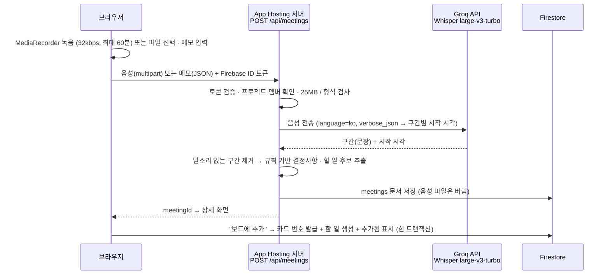

# 음성 인식(STT) 선택

회의록 기능(8~9주차)의 핵심은 회의 녹음을 텍스트로 바꾸는 음성 인식이다. 계획서에는 **네이버 CLOVA Speech**였으나 **Whisper large-v3-turbo (Groq API)** 로 변경한다.

> 결정일: 2026-10-13 · 상태: **구현 완료** (2026-10-15)

---

## 1. 변경 이유

| | CLOVA Speech (기존) | Whisper large-v3-turbo · Groq (변경) |
|---|---|---|
| 비용 | 유료 (개인 프로젝트 예산 없음) | **무료 플랜** 있음 |
| 한국어 정확도 | 높음 | 높음 (Whisper 중 최상위 large-v3 계열) |
| 모델 | 비공개 | **오픈소스** (OpenAI Whisper) |
| 호출 방식 | REST API | REST API (OpenAI 호환) |
| 바뀌는 코드 | – | 서버의 음성 인식 호출 부분만 (`features/meetings/server/groq.ts`) |

## 2. 검토한 후보

| 후보 | 웹 서비스에 넣을 수 있나 | 한국어 정확도 | 비용 | 판단 |
|---|---|---|---|---|
| **Groq API — Whisper large-v3-turbo** | ✅ 서버(Functions)에서 호출 | 높음 | 무료 플랜 | **채택** |
| 브라우저 Whisper (transformers.js, base·small) | ✅ 브라우저에서 직접 실행 | 중간 (작은 모델만 가능) | 무료, 서버 불필요 | 대안 — Groq 한도 초과 · 장애 시 |
| Web Speech API (브라우저 내장) | ✅ 실시간 받아쓰기 | 중상 | 무료 | 제외 — 크롬 전용, 녹음 파일 변환 불가, 음성이 외부(구글)로 전송 |
| whisper.cpp (로컬 PC) | ❌ 개발자 PC가 켜져 있어야 함 | 높음 | 무료 | 개발 중 테스트용으로만 |
| Handy · Whispree · FreeFlow · 오프보이스 | ❌ 개인용 데스크톱/모바일 앱 | – | 무료 | 제외 — 웹 서비스에서 호출할 방법 없음 |
| CLOVA Speech | ✅ | 높음 | 유료 | 제외 — 비용 |

## 3. 처리 구조

처음엔 Storage 업로드 → Cloud Function 트리거로 계획했지만, GitHub 연동을 App Hosting 서버(Next.js API 라우트)로 만들면서 **음성 인식도 같은 서버**에서 처리하도록 바꿨다. Storage · Functions 가 필요 없고, 녹음 파일을 저장하지 않는다.

- API 키(`GROQ_API_KEY`)는 **App Hosting 시크릿(Secret Manager)** 에만 둔다. 브라우저 · 저장소에는 없음 → [보안 설계](SECURITY.md)
- 실패하면 화면에 이유(용량 초과 · 사용량 초과 · 형식 오류)를 보여주고, 같은 화면에서 다시 시도한다 (녹음은 화면에 남아 있음)
- 후보 추출 규칙(키워드 목록)은 `features/meetings/extract.ts` 에 있고, 화면(새 회의록 · 빈 목록)에도 그대로 보여준다
- 한 문장에 여러 일이 이어지면 쉼표 · 연결 어미(~시고, ~구요)에서 나눈다 ("기준씨는 ~해주시고, 시윤씨는 ~해주세요" → 후보 2개)
- 할 일 후보 → 카드 값 (`features/meetings/suggest.ts`): 팀원 이름("기준씨" · "손기준")으로 **담당자**, "금요일까지" · "다음 주 수요일부터" · "10월 20일" 같은 말로 **기간**(회의한 날 기준), 부탁 · 약속 표현을 뗀 **핵심 제목**("비밀번호 찾기"). 추가 전 폼에서 확인 · 수정

## 4. 확인할 것

- [x] 파일 크기 상한: Groq 무료 플랜 25MB → 녹음을 32kbps 로 해서 60분 ≈ 14MB. 올리는 파일은 25MB 넘으면 막음
- [x] Blaze 요금제 전환 (App Hosting 배포 때 완료)
- [ ] Groq 무료 플랜 하루 · 시간당 한도 (GroqCloud 콘솔 Limits 화면에서 확인)
- [ ] 한국어 회의 샘플 1~2개로 정확도 · 후보 추출 확인 (키워드 보정)
- [ ] 사파리 녹음(mp4)은 브라우저가 비트레이트를 무시할 수 있음 → 긴 녹음은 크롬 권장

## 5. 영향 받는 문서

- 계획서(`빅데이터처리_개인프로젝트계획서_상세.docx`): 기술 스택 · 9주차 일정 · 위험 요소
- [Firebase 구조](FIREBASE.md): 구성도 · Functions 표
- [보안 설계](SECURITY.md): 시크릿 표 · 예정 작업
