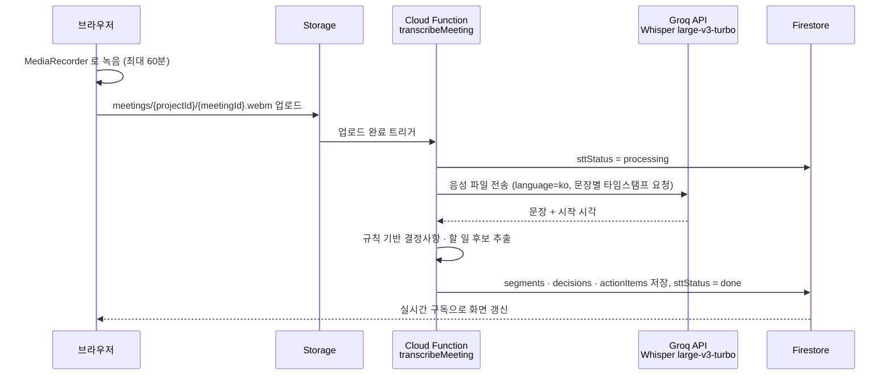

# 음성 인식(STT) 선택

회의록 기능(8~9주차)의 핵심은 회의 녹음을 텍스트로 바꾸는 음성 인식이다. 계획서에는 **네이버 CLOVA Speech**였으나 **Whisper large-v3-turbo (Groq API)** 로 변경한다.

> 결정일: 2026-10-13 · 상태: 확정 (9주차 구현 예정)

---

## 1. 변경 이유

| | CLOVA Speech (기존) | Whisper large-v3-turbo · Groq (변경) |
|---|---|---|
| 비용 | 유료 (개인 프로젝트 예산 없음) | **무료 플랜** 있음 |
| 한국어 정확도 | 높음 | 높음 (Whisper 중 최상위 large-v3 계열) |
| 모델 | 비공개 | **오픈소스** (OpenAI Whisper) |
| 호출 방식 | REST API | REST API (OpenAI 호환) |
| 바뀌는 코드 | – | Cloud Function의 API 호출 부분만. 녹음 · 업로드 · 후보 추출 구조는 그대로 |

## 2. 검토한 후보

| 후보 | 웹 서비스에 넣을 수 있나 | 한국어 정확도 | 비용 | 판단 |
|---|---|---|---|---|
| **Groq API — Whisper large-v3-turbo** | ✅ 서버(Functions)에서 호출 | 높음 | 무료 플랜 | **채택** |
| 브라우저 Whisper (transformers.js, base·small) | ✅ 브라우저에서 직접 실행 | 중간 (작은 모델만 가능) | 무료, 서버 불필요 | 대안 — Groq 한도 초과 · 장애 시 |
| Web Speech API (브라우저 내장) | ✅ 실시간 받아쓰기 | 중상 | 무료 | 제외 — 크롬 전용, 녹음 파일 변환 불가, 음성이 외부(구글)로 전송 |
| whisper.cpp (로컬 PC) | ❌ 개발자 PC가 켜져 있어야 함 | 높음 | 무료 | 개발 중 테스트용으로만 |
| Handy · Whispree · FreeFlow · 오프보이스 | ❌ 개인용 데스크톱/모바일 앱 | – | 무료 | 제외 — 웹 서비스에서 호출할 방법 없음 |
| CLOVA Speech | ✅ | 높음 | 유료 | 제외 — 비용 |

## 3. 처리 구조

- API 키(`GROQ_API_KEY`)는 **Cloud Functions 시크릿**에만 둔다. 브라우저 · 저장소에는 없음 → [보안 설계](SECURITY.md)
- 실패 시 `sttStatus = failed` → 화면의 "다시 시도"로 재호출

## 4. 확인해야 할 것 (9주차 전)

- [ ] Groq 무료 플랜 **실제 한도** — 하루 요청 수, 시간당 오디오 길이, **파일 크기 상한**. GroqCloud 콘솔의 Limits 화면에서 확인 (외부 정리 자료 기준 하루 약 2,000회, 공식 수치 미확인)
- [ ] 파일 크기 상한보다 긴 회의는 **구간을 나눠 전송**할지, 녹음 비트레이트를 낮출지 결정
- [ ] 한국어 회의 샘플 1~2개로 정확도 확인 (규칙 기반 추출이 잘 걸리는지)
- [ ] Cloud Functions 사용을 위한 **Blaze 요금제**(종량제, 무료 사용량 안에서는 과금 없음) 전환

## 5. 영향 받는 문서

- 계획서(`빅데이터처리_개인프로젝트계획서_상세.docx`): 기술 스택 · 9주차 일정 · 위험 요소
- [Firebase 구조](FIREBASE.md): 구성도 · Functions 표
- [보안 설계](SECURITY.md): 시크릿 표 · 예정 작업
